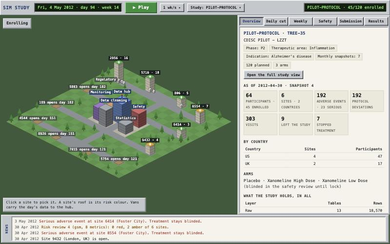

# Sim Study

**A clinical trial you can play, pause and speed up.**

Sim Study puts a clock on a simulated trial. Press Play and the study runs a day at a time:
sites open, participants enrol, data arrives, risk reviews flag sites, the database locks and
the analysis comes out. It is drawn as a small city, with the sites around a sponsor campus.

**▶ Try it: <https://jwildfire.github.io/sim.study/>**

Status: a prototype. Every row is synthetic. Nothing here is qualified, and nothing here is a
submission.

## What it does

- **A clock.** Play, pause, one day at a time, or a day, a week or a month per second.
- **Daily raw data cuts.** The rows of each raw table that are dated today, and to date.
- **Weekly operational snapshots.** Enrolment against plan, screening and discontinuations.
- **Risk-based quality monitoring.** Each month's review of every site on eight metrics, with
  amber and red flags. A site's roof in the city is its risk colour.
- **Safety review.** Adverse events as they arrive, pooled and blinded until the database locks.
- **Lock and analysis.** Treatment codes are released, and adverse events and efficacy come out
  by arm.
- **A road to submission.** A checklist of what a submission needs, showing what is built and
  what is not.

## Two studies to play

| | Pilot study | Made-up trial |
|---|---|---|
| What it is | The CDISC pilot protocol, built by study.builder with gsm.datasim: 12 sites, three arms, seven monthly snapshots | A phase 3 trial invented in the page from a seed |
| Where the data comes from | The building blocks below. Sim Study invents nothing | `sim.js` |
| Risk reviews | gsm's own scores and flags, monthly | A simple weekly check against the study's own rate |
| Charts | safety.viz and gsm.viz, on the study as it stood that month | The page's own small charts |
| Can you change it? | No. It was simulated ahead of time | Yes. Three sites have a hidden problem; send a monitor to find and fix it |

The pilot study opens first. Add `#study=made-up` to the address for the other, and `#seed=42`
for a particular made-up trial.

## Building blocks

Sim Study is a thin layer. The work is done by the projects below.

### Wired in now

| Block | What it does here | Whose |
|---|---|---|
| [study.builder](https://github.com/jwildfire/study.builder) 0.5.0-rc.2 | Builds the study in layers (raw, mapped, ADaM, analysis, reporting) with a snapshot for every month. Sim Study opens one of its ready-made study files and asks it for the study as it stood on any date | Jeremy Wildfire |
| [safety.viz](https://github.com/jwildfire/safety.viz) 1.12.0 | The safety charts: Adverse Event Explorer, Adverse Event Timelines, Hepatic Safety Explorer, Results Over Time, Safety Histogram | Jeremy Wildfire; an update of the [safetyGraphics](https://github.com/SafetyGraphics/safetyGraphics) renderers |
| [gsm.datasim](https://github.com/Gilead-Public/gsm.datasim) 2.1.0 | Simulates every raw row, month by month | Gilead Sciences |
| [gsm.mapping](https://github.com/Gilead-Public/gsm.mapping), [gsm.kri](https://github.com/Gilead-Public/gsm.kri), [gsm.reporting](https://github.com/Gilead-Public/gsm.reporting), [gsm.core](https://github.com/Gilead-Public/gsm.core) | Good Statistical Monitoring: map the raw data, score each site on eight metrics, and shape the results for charts | Gilead Sciences |
| [gsm.viz](https://github.com/Gilead-Public/gsm.viz) 2.4.1 | The site risk chart behind each metric | Gilead Sciences |
| [workr](https://github.com/Gilead-Public/workr) 1.1.0 | Runs every step after raw as a workflow file you can read | Gilead Sciences |
| [CDISC USDM](https://www.cdisc.org/usdm) and the [pilot study definition](https://github.com/cdisc-org/DDF-RA) | The protocol's schedule of activities, as data. Visits, vital signs and labs follow it | CDISC |
| CDISC ADaM, light form | The shape of the analysis tables the charts read: ADSL, ADAE, ADLB, ADVS, ADEG, ADQS | CDISC; built by study.builder's workflows |
| R, by [webR](https://docs.r-wasm.org/webr/latest/) | Everything study.builder builds is built by R in the browser. Sim Study opens a file that R already built, so it starts no R itself | The R and webR projects |

### Planned, not wired

| Block | What it would add |
|---|---|
| [study.viz](https://github.com/jwildfire/study.viz) | One host for every chart on one study, in place of the pop-up charts here |
| gsm.datasim's query, data entry and data change tables | Real data cleaning: queries opening and closing each day |
| An SDTM layer and define.xml | The tabulation datasets a submission needs. study.builder has none yet |
| [pharmaverse](https://pharmaverse.org) | Submission-grade ADaM, and tables, listings and figures from analysis results data |
| [open.csr](https://github.com/jwildfire/open.csr) | The clinical study report at the end |
| Stepping the simulator | Running gsm.datasim a day or a week at a time, so the study can react to what the player does |
| Programs and portfolios | Several studies on one clock |

## What is real and what is not

- Every row is synthetic. A flag on a simulated site says nothing about any real one.
- In the pilot study, Sim Study makes no data. It places each raw row on the day its own date
  says, and it reads gsm's monthly results as they are.
- gsm.datasim builds a study a month at a time, so enrolment arrives in monthly steps and the
  risk reviews and charts are monthly. Weekly snapshots count what has arrived; they do not
  re-run gsm.
- A row dated after the study file's last snapshot is counted on the last day, so the last day's cut is
  larger than it should be.
- The study file holds seven months of a longer study. The analysis is of what was there at
  the last snapshot, so late visits have few participants.
- The rows marked ✗ on the Submission tab are real gaps. There is no SDTM, no tables package
  and no study report.
- The made-up trial is a game. Its datasets and report are ticked off on a timer.

## Run it yourself

Download the files and open `index.html`. There is no build step, no server and no network
call: the libraries and the study file are copied into the repository.

| File | What it is |
|---|---|
| `index.html` | The page and its styles |
| `ui.js` | The clock, the city and the five panels |
| `built.js` | Plays a study that study.builder built |
| `sim.js` | The made-up trial |
| `data/` | The pilot study file, as a script, so the page opens it with no fetch |
| `vendor/` | Copies of study.builder, safety.viz and gsm.viz, byte for byte. `vendor/SOURCE.json` records where each came from and its checksum |

To play a different study, build one with study.builder (with `snapshots: 'all'`), save it as a
study file, and put it in `data/` in place of the pilot.

## Licence

Apache-2.0. See [LICENSE](LICENSE). The copies under `vendor/` keep their own licences,
recorded beside each. The pilot protocol's schedule is from CDISC's DDF reference
architecture, under CC-BY-4.0.

Built by Jeremy Wildfire with Claude Code.
